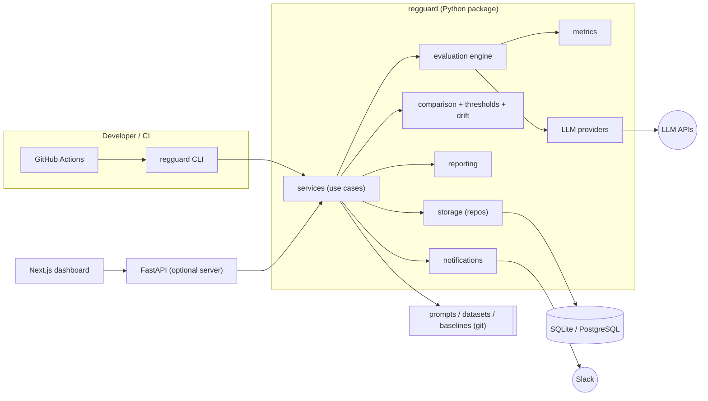
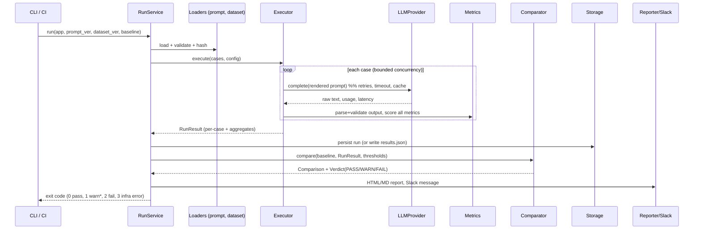
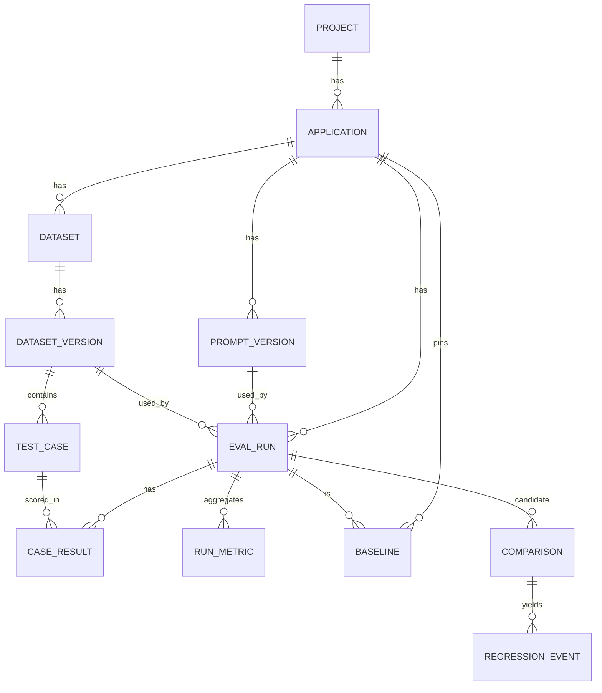

# RegressionGuard — Technical Plan (v0.1, for review)

Status: PROPOSED. No code written. Nothing here is binding until approved (see §14, open questions).

---

## 1. Understanding of the project

RegressionGuard is "CI for LLM behavior". Given (a) a versioned prompt/model config and (b) a versioned, human-labeled golden dataset, it runs the LLM feature on every case, scores each output on several dimensions, **diffs the run against an explicitly chosen baseline**, classifies the result (pass / warn / fail), and surfaces that through a CI gate, an HTML report, Slack, and later a dashboard. A second, slower loop tracks **drift** over many runs.

The product's real value is not "running evals" (many tools do). It is the **decision layer**: *is this change safe to ship, and how sure are we?* Everything below is shaped by that.

First target: support-email classifier (`category` ∈ {billing, technical, account, general} + one-sentence `summary`). The design must not hard-code this: the "application under test" is an adapter + an output schema + a metric list.

Source guide (PDF, Project 1) confirms: Python 3.11+, SQLite + JSON files, Slack webhooks, GitHub Actions on PRs touching `/prompts`, Docker, Streamlit *or* HTML report, 50–100 hand-labeled cases (explicitly **not** LLM-generated), 3%/8% thresholds, 7-run moving-average drift. Your brief goes beyond it (multi-project, dashboard, Postgres, auth); I treat those as post-MVP.

## 2. Critical analysis and recommended changes

### 2.1 Where I'd challenge the brief

| # | Issue | Why it matters | Recommendation |
|---|---|---|---|
| 1 | **3% / 8% thresholds on ~80 cases are mostly noise.** One case = 1.25 pts, so "3%" ≈ 2.4 cases. With LLM nondeterminism, 2–3 cases flip run-to-run on an unchanged prompt. | You'd get constant false alarms, and a gate people learn to ignore is worse than none. | Keep the thresholds but make a verdict depend on **(delta ≥ threshold) AND (evidence)**. Evidence = exact McNemar test on paired per-case outcomes and/or bootstrap CI, plus a minimum count of flipped cases. Offer `gate_mode: threshold \| significant`. Default `significant` for *critical*, plain threshold for *warning*. |
| 2 | **Where does history live in CI?** GitHub runners are ephemeral; a SQLite file is gone after the job. The PDF glosses over this. | Without it "compare to baseline" doesn't work in CI. | Two baselines: **(a) file baseline** — an immutable result snapshot (`baselines/<app>/<name>.json`) committed to the repo, reviewable in the PR, needs no server (this is the CI path); **(b) DB history** — server mode for dashboard/trends/drift. CLI works on (a) alone; API/dashboard adds (b). |
| 3 | **"Baseline = previous run"** (PDF) vs **"explicit baseline"** (your brief). | Previous-run baselines silently ratchet down: A→B (-2%, ok)→C (-2%, ok)… | Your brief is right. Baseline is an explicit, named, pinned run. "Previous run" is shown as secondary info only. Promoting a baseline is a deliberate action (`regguard baseline promote`). |
| 4 | **LLM-as-judge for summaries** is itself non-deterministic and biased. | Judge drift can look like app regression. | Judge model pinned + versioned, temperature 0, rubric-based, **different model family or at least different model from candidate**, judge prompt hashed into the run, and **never the sole gate by default**. Calibrate on a small human-scored subset (report judge-vs-human agreement). Add cheap deterministic proxies (length / single-sentence check, embedding or ROUGE similarity to the reference). |
| 5 | **Scope** (multi-user, projects, auth, Postgres, Slack, Next.js dashboard, CI, drift…) is ~3–4× the PDF's 12-day plan. | Risk of a wide, shallow, unfinished project. | Realistic for a serious solo project **if sequenced**: CLI+engine+comparison first (a complete, demoable product by itself), then storage/API, then dashboard. Estimate 6–8 weeks part-time. See §12. |
| 6 | **Microservices / queues / Redis** | No justification at this scale. | Modular monolith. In-process `asyncio` for runs, run state persisted in DB. Revisit only if multi-tenant or long runs demand it. |
| 7 | **DeepEval / RAGAS** | RAGAS is RAG-specific (irrelevant here). DeepEval is a heavy dependency that duplicates our core and would own our abstractions. | Custom engine with a small `Metric` protocol. Optionally wrap a DeepEval metric as an adapter later. |
| 8 | **Provider-independence via LiteLLM** | Useful, but it's a large dependency with a big transitive surface. | Our own thin `LLMProvider` protocol (scaffold already has `base.py`, `litellm_provider.py`, `mock_provider.py`). LiteLLM is *one adapter*. Pin exact version, review supply-chain posture before adding. Direct OpenAI/Anthropic adapters are ~50 lines each if we drop it. |
| 9 | **Auth/multi-user** | Not needed to prove the thesis. | MVP: single tenant, a static API token for CI→API. Put `project_id` on tables from day one so multi-tenancy is additive, not a rewrite. |

### 2.2 Missing capabilities worth adding (ranked by value)

1. **Response cache** keyed by `hash(provider, model, params, rendered_prompt, input)` — cuts cost, makes reruns deterministic, makes tests fast. Cache is bypassable (`--no-cache`) and never used for latency metrics.
2. **Repeat runs (`n_samples`)** per case for flakiness: report per-case pass rate, mark unstable cases, exclude or down-weight them in gating.
3. **Silent provider drift detection**: a *scheduled* run (nightly, unchanged prompt) catches the vendor changing the model underneath you. This is the strongest real-world justification for drift detection; most people only think of prompt changes.
4. **Cost estimation** from token usage × a pricing table (versioned file).
5. **Failure-case → dataset loop**: `regguard dataset add-from-run` to promote a production failure to a new case (the PDF's "interview talking point").
6. **Dataset versioning with content hash**; comparisons refuse (or loudly warn) when baseline and candidate used different dataset versions.
7. **Pass-rate "per difficulty" and "per category" slices** — an aggregate can hide a collapse in one slice.
8. **Run provenance**: git SHA, prompt hash, dataset hash, model + params, judge version, package version — enough to reproduce.
9. **PR comment** with the summary (PDF mentions it; your brief only says "publish summary").
10. **PII scrubbing check** on dataset ingestion (warn on emails/phones/cards).

### 2.3 Key design decisions (summary)

- **CLI-first core.** Business logic lives in `services/` and pure domain modules. CLI, API, and CI are thin shells over it. CI never needs the server.
- **Pure core, impure edges.** Comparison/threshold/drift code is pure functions over typed data (no I/O) → trivially testable, deterministic.
- **Pairing is by `test_case_id`**, and a case is a regression only if its *pass/fail state* flips (plus metric-level deltas for continuous metrics).
- **Three-valued run status:** `PASS`, `WARN`, `FAIL` (+ `ERROR` for infra failure, which must NOT be reported as a quality regression).

## 3. Technology stack

| Area | Choice | Why | Cons | MVP? | Alternative considered |
|---|---|---|---|---|---|
| Language | Python 3.12 (min 3.11) | Ecosystem, PDF requirement | — | Yes | — |
| Packaging | **uv** + `pyproject.toml` | Fast, lockfile, one tool; good on Windows | Newer than pip/poetry | Yes | poetry, pip-tools |
| API | **FastAPI** + Pydantic v2 | Typed, async, free OpenAPI | — | Phase 6+ | Flask/Django (worse typing story) |
| CLI | **Typer** | Typed, shares Pydantic models | — | Yes | argparse/click |
| Validation/config | Pydantic v2 + pydantic-settings, YAML (`ruamel`/`pyyaml`) | One typing system everywhere | — | Yes | dataclasses (no validation) |
| Async | `asyncio` + `httpx`/provider SDKs, `Semaphore` for concurrency, `tenacity` for retries | Right-sized | — | Yes | Celery/Redis (overkill) |
| Background jobs | `asyncio.create_task` + DB-persisted status; later ARQ/RQ if needed | No new infra | Lost on process crash → resume logic | Phase 6 | Celery |
| LLM access | Own `LLMProvider` Protocol; adapters: OpenAI, Anthropic, LiteLLM (optional), Mock | Testable, swappable | Slight extra code | Yes (OpenAI + Mock) | LiteLLM only |
| Eval | Custom `Metric` protocol + registry; deterministic metrics + LLM judge | Control, no heavy deps | We write metrics | Yes | DeepEval (later adapter), RAGAS (n/a) |
| Stats | `scipy.stats` (McNemar/binomial), `numpy` bootstrap | Standard | scipy is large | Yes (or pure-python exact test to avoid scipy) | statsmodels |
| DB | **SQLite** default, **PostgreSQL** via `DATABASE_URL` | Zero-infra locally, prod-ready path | Must avoid PG-only features | SQLite yes / PG Phase 10 | Postgres-only (heavier dev loop) |
| ORM/migrations | SQLAlchemy 2.0 (async) + **Alembic** | Standard (scaffold has alembic.ini) | Learning curve | Phase 6 | SQLModel, raw SQL |
| Frontend | **Next.js (App Router) + TypeScript + Tailwind + shadcn/ui + TanStack Query + Recharts** | Real SaaS look, strong ecosystem; types generated from OpenAPI | More moving parts than Streamlit | Phase 8 | Streamlit (fast, but not "SaaS-grade" and weak for side-by-side diffs); plain HTML report (kept for CI) |
| Reports | Jinja2 → self-contained HTML (inline CSS/JS) | Works as CI artifact, no server | — | Yes | — |
| Notifications | Slack **incoming webhook** | Simplest, no OAuth | One channel, no threading | Yes | Slack App/Web API (later) |
| Quality | ruff (lint+format), mypy `--strict` on core, pytest, pytest-asyncio, coverage, pre-commit | Scaffold has `.pre-commit-config.yaml` | — | Yes | black+flake8 |
| Frontend tests | Vitest + Playwright | — | — | Phase 8 | Cypress |
| DevOps | Docker (multi-stage, non-root), Docker Compose, GitHub Actions | Per PDF/brief | — | Docker Phase 10 | — |
| Observability | `structlog` JSON logs; `/healthz`; optional OpenTelemetry later | Enough for v1 | — | Logs yes | Prometheus/Grafana (later, optional) |
| Security tooling | `pip-audit`, `bandit`, `gitleaks` (pre-commit), Trivy for image, Dependabot | Cheap, high value | — | Yes | — |

Recommended balance: **Python/uv/FastAPI/Typer/SQLAlchemy+SQLite→Postgres/custom metrics/Next.js**. Deliberately omitted: Redis, Celery, Kubernetes, microservices, vector DB, Kafka, GraphQL.

## 4. High-level architecture

Modular monolith, one deployable backend, one frontend, one DB.



**Dependency rule (enforce with import-linter later):**
`api, cli → services → {evaluation, comparison, reporting, notifications, storage} → {metrics, providers} → core (types, config, errors)`.
`core`, `metrics`, `comparison` contain **no I/O**. Only `providers`, `storage`, `notifications`, `reporting`, file loaders touch the outside world.

## 5. Component architecture

| Component | Responsibility | Independent module vs service |
|---|---|---|
| `core` | Shared Pydantic types (`RunConfig`, `CaseResult`, `MetricScore`, `RunSummary`, `Verdict`), settings, error hierarchy, ids | module |
| `providers` | `LLMProvider.complete(request) -> Completion(text, usage, latency, raw)`; retry/timeout policy lives in the executor, not providers | module (adapters) |
| `prompts` | Load/validate versioned YAML, render with inputs, content-hash | module |
| `datasets` | Load JSONL cases, validate schema, content-hash, version, PII lint | module |
| `evaluation` | `executor` (bounded-concurrency, retry, timeout, cache, n-samples), `runner` (orchestrates a full run → `RunResult`) | module |
| `metrics` | `Metric` protocol + registry: `category_exact`, `precision_recall_f1`, `schema_valid`, `summary_judge`, `summary_similarity`, `latency`, `tokens`, `cost` | module (plugin-style) |
| `comparison` | `diff(baseline, candidate)` → case flips, metric deltas, slice deltas; `thresholds` → verdicts; `stats` → significance; `drift` → moving average | pure module |
| `reporting` | Jinja2 HTML, Markdown (PR comment), JSON | module |
| `notifications` | Slack webhook formatter + sender (idempotent, failure-tolerant, never fails a run) | module |
| `storage` | SQLAlchemy models + repositories; file baseline store | module |
| `services` | Use cases: `run_evaluation`, `compare_runs`, `promote_baseline`, `check_drift`, `publish_results` | the application layer |
| `api` | FastAPI routers, DTOs, dependency wiring, static-token auth | service (process) |
| `cli` | Typer commands | entrypoint |
| Frontend | Dashboard consuming OpenAPI-generated client | separate app |

### Evaluation sequence


\* warn exit code configurable (default 0 so PRs aren't blocked by warnings).

## 6. Database design

**MVP storage = files** (run results JSON + committed baselines). **DB arrives in Phase 6** and must be a superset of the file format (same Pydantic models serialized). Only 9 tables needed; skip `users`/`notifications` in MVP.



| Table | Key columns | Notes |
|---|---|---|
| `project` | id, name, slug | Single row in MVP; present for future multi-tenancy |
| `application` | id, project_id FK, slug, output_schema_ref, metric_config JSON | |
| `prompt_version` | id, application_id FK, version, content_hash UNIQUE(app,hash), body JSON, git_sha | Immutable |
| `dataset_version` | id, dataset_id FK, version, content_hash, case_count | Immutable |
| `test_case` | id (stable string), dataset_version_id FK, input JSON, expected JSON, difficulty, category, notes | |
| `eval_run` | id, application_id, prompt_version_id, dataset_version_id, provider, model, params JSON, judge_config JSON, git_sha, trigger (`ci/manual/schedule`), status, started_at, finished_at, cost_usd, error | Indexed `(application_id, started_at DESC)` |
| `case_result` | id, run_id FK, test_case_id, sample_idx, raw_output TEXT, parsed_output JSON, schema_valid, passed, scores JSON, latency_ms, prompt_tokens, completion_tokens, error_type | UNIQUE(run_id, test_case_id, sample_idx); raw output kept for diffing |
| `run_metric` | run_id, name, value, ci_low, ci_high, slice | Aggregates, one row per metric×slice; indexed `(name, run_id)` for trends |
| `baseline` | id, application_id, name, run_id FK, pinned_by, created_at, is_active | One active per (app,name) |
| `comparison` | id, baseline_run_id, candidate_run_id, thresholds JSON, verdict, summary JSON | Cached so reports are reproducible |
| `regression_event` | id, comparison_id, kind (`case_flip`, `metric`, `drift`), severity, subject, detail JSON | Drives alerts/dashboard |

Later: `user`, `api_token`, `audit_log`, `notification_log`.
Retention: raw outputs are the biggest rows → configurable retention (e.g. keep raw for 90 days, aggregates forever). Migrations: Alembic, autogenerate reviewed by hand, forward-only, tested with an up/down/up CI step; same migrations must pass on SQLite and Postgres (no PG-only types — use JSON, not JSONB, in models; add PG-specific indexes only via dialect guard).

## 7. Evaluation engine design

**Metric protocol** (extensible by registering a class):
```
class Metric(Protocol):
    name: str; kind: Literal["binary","continuous"]; higher_is_better: bool
    async def score(case, output, ctx) -> MetricScore   # per case
    def aggregate(scores) -> AggregateScore             # per run, with optional CI
```
Metrics are listed in the app's `regguard.yaml` with their gate settings; the comparator treats any metric generically (binary → McNemar, continuous → paired bootstrap/Wilcoxon-lite).

**Default metrics (email classifier)**
- `schema_valid` — Pydantic validation of the model's JSON. Failure ⇒ case fails; reported separately from "wrong category" because the fixes differ.
- `category_exact` — binary; plus per-class precision/recall/F1 and macro-F1 and confusion matrix (accuracy alone hides minority-class collapse).
- `summary_quality` — hybrid: deterministic checks (non-empty, one sentence, length bounds, no copy-paste of the email) **+** embedding/ROUGE similarity to reference **+** LLM judge 1–5 with rubric. Gate on the deterministic + similarity by default; judge is reported and gated only when opted in and calibrated.
- `latency_ms` (p50/p95, from non-cached calls only), `tokens` (prompt/completion/total), `cost_usd`.
- `overall_score` — user-defined weighted composite, **informational**; gates act on individual metrics so a gain in one can't hide a loss in another.

**Reliability**
- Bounded concurrency (`asyncio.Semaphore`), per-request timeout, exponential backoff with jitter on 429/5xx/timeouts, max attempts; non-retryable errors (400, auth) fail fast.
- Infra failures produce `error_type` on the case; if error rate > X% the run is `ERROR`, **not** a quality regression. Errored cases are excluded from paired comparisons and counted separately.
- Reproducibility: temperature 0 / fixed seed where supported, but we assume this is *not* enough → `n_samples`, cache, full provenance recorded.
- Cost control: dry-run estimate before running (`regguard run --estimate`), `max_cost_usd` hard stop, cache, cheap default model.
- Prompt-injection: dataset emails are untrusted input; judge prompt delimits them and instructs to ignore embedded instructions; judge output schema-validated. Include a few injection-style cases in the golden set.

## 8. Regression detection & drift

**Case-level:** for each shared `test_case_id` → `REGRESSED` (pass→fail), `IMPROVED` (fail→pass), `UNCHANGED`, plus `NEW`/`REMOVED` if dataset versions differ (and a loud warning). For continuous metrics, a case "regresses" when the score drops by more than a per-metric epsilon.

**Metric-level default thresholds** (per metric, in the app config; deltas are *candidate − baseline*, expressed in the metric's natural unit):

| Metric | Warn | Critical | Unit |
|---|---|---|---|
| `category_exact` | −3 pts | −8 pts | absolute percentage points |
| `schema_valid` | any drop | −2 pts | pp (should be ~100%) |
| per-category recall | −5 pts | −12 pts | pp (small slices → wider) |
| `summary_quality` | −5% | −10% | relative |
| `latency_p95` | +25% | +60% | relative increase |
| `tokens_total` / `cost` | +20% | +50% | relative increase |

Your 3%/8% are sensible *defaults for accuracy* but wrong as a universal rule; schema validity and latency need different scales.

**Verdict rule (default):**
`FAIL` if any gated metric ≥ critical **and** (significant at α=0.10 **or** ≥ `min_flips` regressed cases); `WARN` if ≥ warn; else `PASS`. Also `FAIL` on hard rules (e.g. schema_valid < 95%, regressed "must-pass" cases tagged `critical: true` in the dataset). Everything configurable; every verdict includes a machine-readable "why".

**Statistics (honest limits):** with n≈80, an exact McNemar test needs roughly ≥6 discordant pairs to ever reach p<0.05 with all-one-direction flips; many small real regressions are therefore *undetectable* — we say so in the report ("inconclusive: low power, n=80") instead of pretending. Show Wilson/bootstrap CIs on every rate. Multiple metrics ⇒ gate only on a short list to limit multiple-comparison false alarms. Bigger fix: grow the dataset from real failures.

**Drift:** over the last N *comparable* runs (same dataset hash, same metric definitions, same trigger class — e.g. `main`/scheduled only, not experimental PR runs), compute a moving average (default N=7) and compare it to the baseline mean; also a simple slope test. Fire `DRIFT_WARNING` when MA falls ≥ `drift_warn` below the reference *and* each of the last k runs is below it (avoids one-off dips); reset the window when the dataset or metric definition changes. Scheduled nightly runs of the *unchanged* config are what make drift meaningful. Alert deduplication: one alert per drift episode, not per run.

## 9. Repository structure

Builds on your existing scaffold (✓ = already exists as empty file/dir).

```
regression-guard/
├─ CLAUDE.md                         ✓ root engineering rules + status log (MVP)
├─ README.md                         ✓ onboarding-style docs (MVP; written last)
├─ .env.example                      ✓ names only, no secrets
├─ .gitignore  .editorconfig  LICENSE           (add)
├─ .pre-commit-config.yaml           ✓ ruff, mypy, gitleaks, EOF/whitespace
├─ docker-compose.yml                ✓ backend (+ postgres profile, frontend later)
├─ .claude/
│  ├─ settings.json                  ✓ permissions + hooks (see §10)
│  ├─ agents/                        ✓ code-reviewer.md, test-writer.md
│  ├─ skills/                        ✓ add-metric/, add-testcase/
│  └─ commands/                      (add) /status, /phase-done
├─ .github/workflows/
│  ├─ ci.yml                         ✓ lint+type+test+audit on every PR (MVP)
│  └─ evaluate.yml                   ✓ eval gate on prompts/dataset/config changes (MVP)
├─ backend/                          
│  ├─ CLAUDE.md                      ✓ Python conventions, layering rule
│  ├─ pyproject.toml                 ✓ deps, ruff, mypy, pytest config; `regguard` script
│  ├─ alembic.ini ✓ / migrations/ ✓  Phase 6
│  ├─ Dockerfile                     Phase 10
│  ├─ src/regguard/
│  │  ├─ __init__.py                 ✓ version
│  │  ├─ core/        types.py, config.py, errors.py, ids.py, logging.py      (MVP)
│  │  ├─ providers/   base.py ✓ litellm_provider.py ✓ mock_provider.py ✓ openai_provider.py   (MVP)
│  │  ├─ prompts/     loader.py, models.py, render.py                          (MVP)
│  │  ├─ datasets/    loader.py, models.py, pii_lint.py                        (MVP)
│  │  ├─ evaluation/  executor.py ✓ runner.py ✓ cache.py                       (MVP)
│  │  ├─ metrics/     base.py, registry.py, classification.py, schema.py,
│  │  │               summary.py, performance.py                               (MVP)
│  │  ├─ comparison/  diff.py, thresholds.py, stats.py, drift.py, verdict.py   (MVP; drift Ph5)
│  │  ├─ reporting/   html.py, markdown.py, templates/*.j2                     (MVP)
│  │  ├─ notifications/ slack.py ✓                                             (MVP)
│  │  ├─ storage/     models.py, session.py, repositories.py, file_store.py    (Ph6; file_store MVP)
│  │  ├─ services/    run_service.py, compare_service.py, baseline_service.py, drift_service.py
│  │  ├─ api/         main.py, deps.py, auth.py, routers/{runs,compare,baselines,prompts,datasets,health}.py  (Ph6+)
│  │  └─ cli/         main.py (Typer: run, compare, baseline, report, dataset, drift)  (MVP)
│  └─ tests/  unit/ ✓ integration/ ✓ fixtures/ ✓ (+ e2e/ later)
├─ frontend/                         Phase 8
│  ├─ CLAUDE.md ✓   package.json, next.config.ts, tailwind config
│  ├─ src/app/ ✓     (routes: overview, runs, runs/[id], compare, prompts, datasets, cases, trends, settings)
│  ├─ src/components/ ✓  ui/ (shadcn), charts/, diff/, layout/
│  ├─ src/lib/ ✓     api client (generated from OpenAPI), formatters
│  └─ tests/e2e/ ✓   Playwright
├─ examples/support-email-classifier/ ✓
│  ├─ regguard.yaml ✓            app definition: schema, metrics, thresholds, provider
│  ├─ prompts/classify/v1.yaml ✓ v2.yaml ✓
│  └─ datasets/emails/v1/cases.jsonl ✓   (hand-written, 60→80 cases)
├─ baselines/                        committed immutable baseline snapshots (MVP)
├─ infra/                            Dockerfiles, nginx/caddy sample, deploy notes (Ph10)
├─ scripts/                          dev helpers (seed, estimate-cost)
└─ docs/
   ├─ technical-plan.md              this file
   ├─ architecture.md ✓             living architecture doc (after approval)
   ├─ adr/ ✓                        0001-modular-monolith.md, 0002-file-baselines-in-ci.md, 0003-significance-gating.md …
   ├─ diagrams/ ✓                   mermaid sources
   └─ security.md, runbook.md       (Ph10–11)
```

Conventions: `src/` layout; absolute imports (`from regguard.comparison import diff`); no cross-layer imports (enforced by `import-linter`); all config via `pydantic-settings` reading env vars prefixed `REGGUARD_` (e.g. `REGGUARD_OPENAI_API_KEY`, `REGGUARD_SLACK_WEBHOOK_URL`, `DATABASE_URL`); app/prompt/threshold config lives in versioned YAML, **secrets only in env**; shared types live in `core/types.py` and are the single source for API schemas → OpenAPI → TS client.

Prompt file shape: `id, version, created_at, model_hint?, system, few_shot[], output_schema_ref` (content-hash computed, not trusted from file). Dataset case: `{id, input:{email}, expected:{category, summary}, difficulty, tags[], critical?, notes}`.

## 10. Claude Code configuration

| Feature | What it does | Use here? |
|---|---|---|
| **CLAUDE.md** (root + `backend/` + `frontend/`) | Persistent instructions loaded by directory | **Yes** — already scaffolded. Root: working rules from your §14, layering rule, commands, status log. Subdir files: language-specific conventions. Keep each < ~150 lines. |
| **settings.json permissions** | allow/deny tool & command patterns | **Yes** — allow `uv run pytest/ruff/mypy`, `git status/diff/log`, `docker compose config`; deny reading/writing `.env*`, `rm -rf`, `git push --force`, `curl \| sh`. Ask for `git commit/push`, `pip/uv add`. |
| **Hooks** | Deterministic scripts on events | **Yes, two only:** PostToolUse on Edit/Write of `*.py` → `ruff format && ruff check --fix`; PreToolUse blocking edits to `.env` and `baselines/*` (baselines change only via CLI). Optional Stop hook running fast unit tests. |
| **Subagents** (`.claude/agents`) | Isolated specialist contexts | **Yes, two:** `code-reviewer` (read-only, checks layering/typing/tests), `test-writer`. More is clutter. |
| **Skills** (`.claude/skills`) | Reusable procedures loaded on demand | **Yes, two:** `add-metric` (checklist: protocol, registry, tests, docs, config), `add-testcase` (schema, no-LLM-generated rule, PII lint). |
| **Slash commands** | Saved prompts | Small: `/status` (update status log), `/phase-done` (run tests, update CLAUDE.md status, propose commit). |
| **Plan mode** | Read-only planning before edits | **Yes** at the start of every feature (§12). |
| **Context mgmt** | `/clear` between phases, `/compact` mid-phase, keep plan docs in repo | Yes. State lives in the repo (CLAUDE.md status + ADRs), not in chat history. |

**Distinctions:** *Plugins* bundle skills/agents/hooks/MCP for distribution; *MCP servers* give Claude external tools/data; *skills* are instruction packs; *hooks* are deterministic shell automation; *VS Code extensions* are editor features Claude Code doesn't use. I haven't verified the plugin marketplace contents for this session — before installing any, check `/plugin` and read its source. You don't need any plugin to start.

### MCP servers (minimal set)

| Server | Verdict | Why | Install (verify against current docs before running) | Permissions / risk |
|---|---|---|---|---|
| **GitHub (official)** | Install at Phase 9 | Issues/PRs/Actions logs from inside Claude; useful for debugging the eval workflow | `claude mcp add --transport http github https://api.githubcopilot.com/mcp/ --header "Authorization: Bearer <PAT>"` | Fine-grained PAT, single repo, read + PR/issues write only. Token lives in user config, never committed. `gh` CLI already covers much of this — optional. |
| **Context7** | Install now | Up-to-date docs for FastAPI/SQLAlchemy 2/Pydantic v2/Next.js/LiteLLM — these APIs change fast | `claude mcp add context7 -- npx -y @upstash/context7-mcp` | Sends your queries to a third party; no repo content needed. Low risk. |
| **Playwright MCP** | Install Phase 8 only | Let Claude drive/verify the dashboard | `claude mcp add playwright -- npx @playwright/mcp@latest` | Controls a browser; only point at localhost. |
| **PostgreSQL MCP** | Optional, Phase 10 | Inspect schema/data | Use a **read-only** DB role | Never give write creds. Plain `sqlite3`/`psql` via Bash is enough before then. |
| Filesystem MCP | **Skip** | Claude Code already has file tools | — | — |
| Sequential Thinking | **Skip** | Plan mode + extended thinking cover it | — | — |
| Docker MCP | **Skip** | `docker compose` via Bash is enough | — | — |

VS Code extensions (editor-only): Python + Pylance, Ruff, Mypy Type Checker, Docker, GitHub Actions, YAML (Red Hat), Mermaid preview, Even Better TOML, ESLint/Tailwind IntelliSense (Phase 8), Thunder Client or use FastAPI's `/docs`.

## 11. Working workflow with Claude Code

Per feature (loop): **1) Plan mode** — I read the relevant files, state what/why, list exact files to create/modify, tests to add → **you approve** → **2) Implement** the smallest vertical slice, tests alongside → **3) Verify** — run `ruff`, `mypy`, `pytest`; report real output, including failures → **4) Review** — `code-reviewer` subagent checks layering/typing/edge cases → **5) Update** CLAUDE.md status + docs/ADR if a decision changed → **6) Commit** (conventional commits, one logical change, you approve each commit). One phase per session; `/clear` between phases. Architectural changes are proposed as an ADR first.

## 12. Roadmap

Phase numbering follows your list. Time = part-time estimate. "Accept." = acceptance criteria.

| Ph | Goal | Key deliverables / files | Acceptance & tests |
|---|---|---|---|
| **0** (½ d) | Planning + env | This plan approved; `git init`; tools verified; CLAUDE.md filled; ADR 0001–0003 | `uv --version`, `docker --version`, `node -v`, `gh auth status` ok; repo committed |
| **1** (1 d) | Foundation | `pyproject.toml`, `core/{types,config,errors,logging}`, Typer skeleton `regguard --version`, pre-commit, `ci.yml` | `ruff`, `mypy --strict`, `pytest` green in CI on empty-ish project |
| **2** (2 d) | Providers + prompts | `providers/{base,mock,openai}`, `prompts/{loader,render}`, v1/v2 YAML, email-classifier `AppDefinition` | Unit tests w/ mock provider; hash stable; invalid YAML rejected; one **manual** real-API smoke test |
| **3** (2–3 d + labeling) | Golden dataset | `datasets/loader`, schema, PII lint, 60 hand-written cases (≈15/category; ~25% hard: ambiguous, typos, mixed-language, sarcasm, injection), `dataset validate` command | Loader tests; distribution report; dataset hash deterministic |
| **4** (3–4 d) | Evaluation engine | `evaluation/{executor,runner,cache}`, concurrency/retry/timeout/n-samples, `regguard run` → `results.json` | Mock-provider integration tests incl. 429s, timeouts, malformed JSON; deterministic w/ seed; cost estimate |
| **5** (4–5 d) | Metrics + regression detection | `metrics/*`, `comparison/{diff,thresholds,stats,verdict,drift}`, `regguard compare`, baseline snapshot commands | Property tests (diff symmetry, identical runs ⇒ PASS, injected 10% regression ⇒ FAIL), McNemar vs scipy reference, threshold-config tests |
| **6** (3–4 d) | DB + history (+ API) | `storage/*`, Alembic migration 0001, repositories, FastAPI routers (runs/compare/baselines), token auth, OpenAPI | Migration up/down on SQLite **and** Postgres (compose); API tests w/ httpx; CLI can `--store` to DB |
| **7** (2–3 d) | Reports + Slack | Jinja2 HTML (scorecard, regression table with old/new side-by-side, trend), Markdown PR comment, Slack blocks, drift alert | Golden-file tests for HTML/MD; Slack tested with mocked webhook + a real test channel |
| **8** (7–10 d) | Dashboard | Next.js app, 10 pages from the brief, OpenAPI-generated client, loading/error/empty states, a11y basics | Vitest components, Playwright e2e vs seeded DB; Lighthouse sanity |
| **9** (2 d) | CI/CD | `evaluate.yml`: path filters, run eval (mock in tests / real on `main` & trusted PRs), PR comment, artifact upload, exit-code gate, merge-blocking via required check | Demo PR with a deliberately bad prompt fails the check; docs for secrets |
| **10** (3–4 d) | Hardening + deploy | Dockerfiles (multi-stage, non-root), compose profiles, `pip-audit`/Trivy in CI, rate limiting, audit log, structured logs, Postgres deploy notes (single VM or Fly/Render) | `docker compose up` e2e; scans clean or triaged; load-sanity test |
| **11** (2–3 d) | Docs + portfolio | README (onboarding style), architecture + ADRs, runbook, 3-min demo, blog post | A new person can run it from README in <15 min |

**Fork-PR / secrets note (Phase 9):** `pull_request` from forks has no secrets (good — eval falls back to cache/mock or is skipped). Never use `pull_request_target` to run PR code with secrets.

### MVP vs later

- **MVP (end of Phase 5 + 7-lite + 9):** CLI, prompt/dataset loaders, hand-labeled dataset, engine, deterministic metrics + LLM judge, file baselines, threshold+significance verdicts, HTML report, Slack, GitHub Action with merge gate. *That alone is a complete, demoable, interview-worthy project.*
- **v1:** DB history, API, drift detection over history, dashboard, Docker/Postgres deploy.
- **Later:** auth/multi-user/RBAC, multiple apps beyond the example, DeepEval adapter, human-review UI for labels, A/B across models, OpenTelemetry/Prometheus, Slack App (threads/buttons).

## 13. Risks and mitigations

| Risk | Mitigation |
|---|---|
| Flaky/noisy results cause false alarms | Significance gating, `n_samples`, flaky-case flagging, scheduled A/A runs to measure noise floor |
| Dataset too small / unrepresentative | Stratified hand-labeled set, difficulty tags, failure-driven growth, report low-power honestly |
| Judge bias / drift | Pinned judge, calibration subset, non-gating by default |
| API cost/rate limits | Cache, mini-model default, `max_cost_usd`, concurrency cap, dry-run estimate |
| Scope creep (dashboard eats the schedule) | MVP defined without dashboard; dashboard strictly after DB+API |
| Secrets leakage (API keys, Slack URL, PII in datasets) | env-only secrets, gitleaks pre-commit + CI, PII lint, deny-list `.env` for Claude, no real customer data in repo |
| Supply-chain (LiteLLM etc.) | Pin versions + lockfile, `pip-audit`, Dependabot, thin provider layer so a dependency is removable |
| Vendor silently updates model | Scheduled nightly runs + drift alerts, record exact model string/system fingerprint |
| Baseline staleness / unfair comparison | Dataset-hash check, explicit promotion, baseline age shown in report |
| Windows dev quirks (paths, line endings) | `.gitattributes` (LF), pathlib everywhere, Docker for parity |
| Unverified AI-written code | Test-first-ish loop, mypy strict on core, reviewer subagent, no "done" without green output |

## 14. Open questions (need your input)

1. **LLM provider & budget:** OpenAI (PDF default, `gpt-4o-mini` ≈ pennies per 80-case run) or Anthropic, or both? Do you already have an API key and a spending limit?
2. **Judge model:** OK to use a different model/provider for the summary judge than for the classifier?
3. **Dataset authorship:** Will you hand-write the first ~60 emails (I can supply a *template/checklist* and review them, but not generate the ground truth)?
4. **Repo visibility:** Public GitHub (portfolio) ⇒ forks can open PRs ⇒ affects the secrets design. Public or private?
5. **Slack:** Do you have a workspace where you can create an incoming webhook for testing?
6. **Frontend timing:** Fine to defer the dashboard until the CLI/engine/CI path is solid (my strong recommendation)?
7. **Approve these three decisions:** (a) modular monolith, (b) file baselines for CI + DB for history, (c) significance-aware gating.

### 14.1 Answers received (2026-11-09)

1. Providers: OpenRouter or Groq (free keys). Both are OpenAI-compatible, so a single `openai_compatible` adapter with a configurable `base_url` replaces LiteLLM entirely (supersedes §2.1 #8 and the LiteLLM adapter in §3). Free tiers have tight rate limits: default concurrency 2-4, cache on, backoff honoring `Retry-After`.
2. Judge may be a different model: yes.
3. Dataset: user is unsure how to start. Plan: in Phase 3 provide a labeling guide (category definitions, edge-case checklist, case template); user writes the emails. No LLM-generated labels.
4. Repo private for now (fork-PR concern deferred).
5. Slack: no experience. Console/file notifier first; Slack webhook setup is a short guided step in Phase 7 (free workspace, ~5 minutes).
6. Dashboard deferred: yes.
7. Modular monolith, file baselines + DB history, significance-aware gating: approved (ADRs 0001-0003).

Environment finding: system Python is 3.14.3. We pin Python 3.12 via uv to avoid wheel/tooling gaps. `gh` CLI not installed (needed by Phase 9).

## 15. Recommended starting point

Approve §14 → Phase 0/1: `git init`, fill root `CLAUDE.md` + 3 ADRs, then the `core` types and the **mock provider + prompt loader** (smallest vertical slice with tests). The very first real engineering decision is the shape of `RunResult`/`CaseResult` in `core/types.py`, because comparison, storage, API, and the dashboard all derive from it — I'll propose it in Plan mode before writing it.
